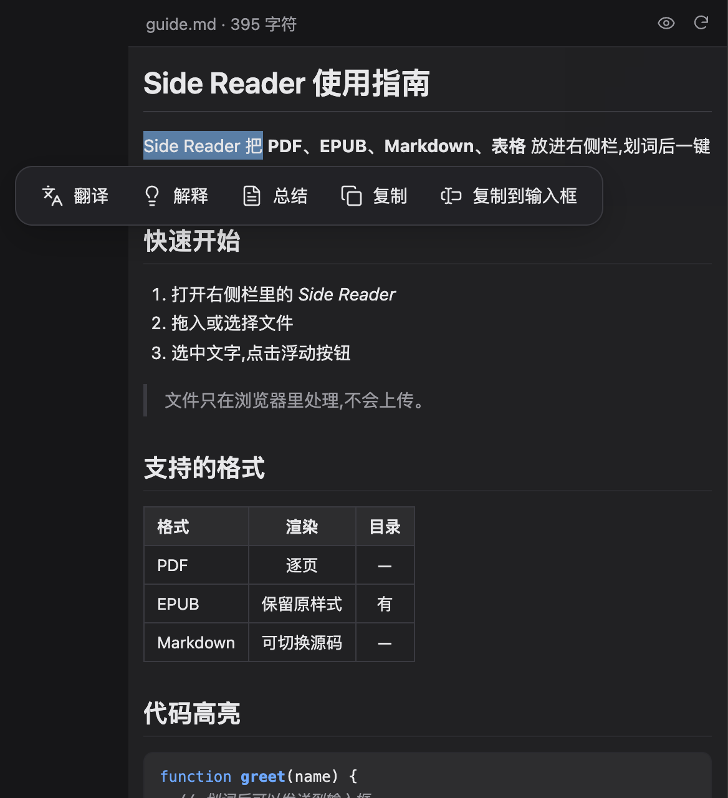
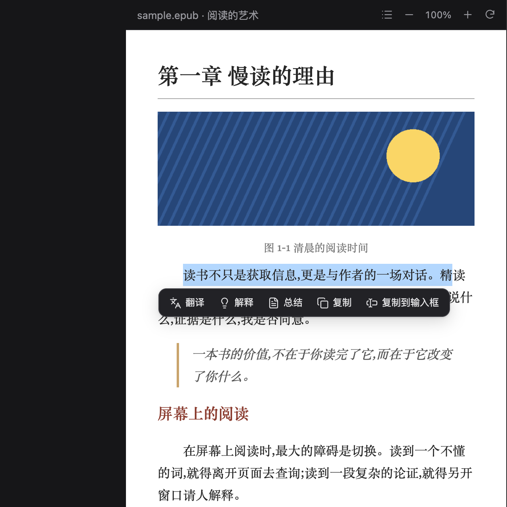
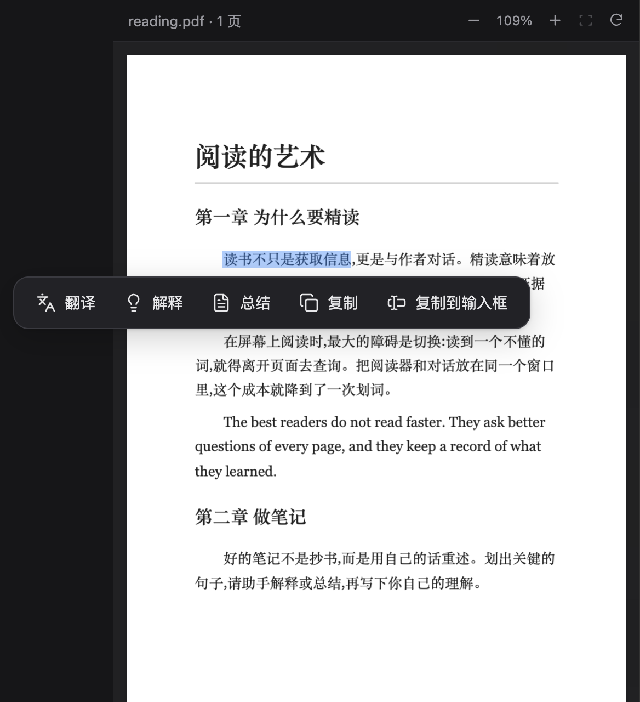
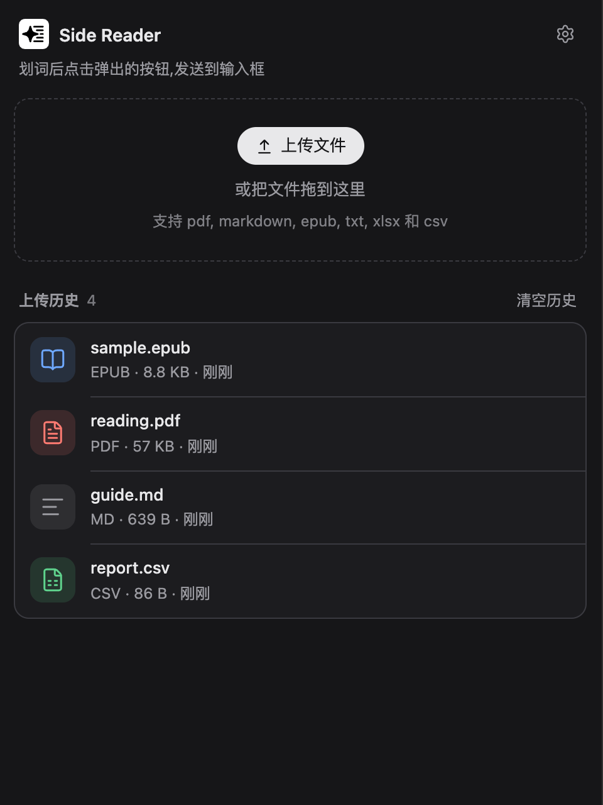

# Side Reader

[中文](#中文) | [English](#english)

## 中文

Side Reader 是 DeepSeek Harness(DSH)的右侧栏阅读插件。在侧边栏里打开文档,划词后点按钮,把选中的文字翻译、解释、总结、复制,或直接发到输入框。

### 功能

- 阅读 PDF、EPUB、Markdown、TXT、XLSX、CSV。上传过的文件保存在浏览器本地,可从历史列表重新打开。
- PDF:缩放、适应宽度,文字可选。
- EPUB:保留书自己的样式和图片,有目录和字号调节。
- Markdown:可渲染(标题、表格、代码高亮、任务列表、脚注等),点眼睛图标切换为带 `#` 的源码。
- 划词后弹出工具栏:翻译、解释、总结、复制、发到输入框。按钮可新增、删除、改图标、拖动排序,也可折叠到下拉菜单。
- 文件只在你的浏览器里处理,插件不会上传文件。

### 截图

| Markdown 渲染与划词 | EPUB 阅读 |
|---|---|
|  |  |

| PDF 划词 | 文件历史 | 自定义按钮 |
|---|---|---|
|  |  |  |

### 安装

```sh
dsh plugin --profile <profile 名> add dsh-side-reader
```

或从 GitHub / tarball 安装,见 [DSH 打包与安装文档](https://github.com/deepseek-ai/deepseek-harness/blob/master/docs/user/develop/basic/publish.zh.md)。本插件不需要构建步骤。

装好后,在右侧栏的“Side Reader”入口里上传文件。Side Reader 不接管 `*.pdf` 的默认打开方式,只通过自己的入口打开文件。

### 限制

- 加密(DRM)的 EPUB、固定版式 EPUB 未测试。
- Markdown 不支持数学公式和 Mermaid 图。
- 旧版 `.xls` 能打开,但上传框里没有列出。

### 许可

MIT,见 [LICENSE](LICENSE)。

内置的第三方代码保留各自的许可证,文件随包附带:

| 组件 | 用途 | 许可证文件 |
|---|---|---|
| PDF.js | PDF 渲染 | `LICENSE.pdfjs.txt` (Apache-2.0) |
| SheetJS CE | Excel / CSV 解析 | `LICENSE.sheetjs.txt` (Apache-2.0) |
| JSZip | zip 读取(以 MIT 许可使用) | `LICENSE.jszip.txt` |
| Lucide | 图标 | `LICENSE.lucide.txt` (ISC) |
| marked、marked-footnote、DOMPurify(以 Apache-2.0 使用)、highlight.js | Markdown 渲染 | `LICENSE.markdown.txt` |
| epub.ts | EPUB 渲染 | `LICENSE.epub.txt` (BSD-2-Clause) |

## English

Side Reader is a right-sidebar reader for DeepSeek Harness (DSH). Open a document in the sidebar, select text, and translate, explain, summarize or copy it, or send it straight to the composer.

### Features

- Reads PDF, EPUB, Markdown, TXT, XLSX and CSV. Uploaded files stay in your browser and can be reopened from the history list.
- PDF: zoom, fit to width, selectable text.
- EPUB: keeps the book's own styles and images, with a table of contents and font size control.
- Markdown: rendered view (headings, tables, syntax highlighting, task lists, footnotes and more). The eye icon switches to the raw source with `#` marks.
- Selection toolbar: translate, explain, summarize, copy, send to composer. Buttons can be added, removed, given another icon, reordered by dragging, or folded into a menu.
- Files are processed in your browser only. The plugin does not upload them.

### Screenshots

| Markdown with selection toolbar | EPUB reader |
|---|---|
|  |  |

| PDF selection | File history | Custom buttons |
|---|---|---|
|  |  |  |

### Install

```sh
dsh plugin --profile <profile> add dsh-side-reader
```

Or install from GitHub or a tarball; see the [DSH packaging guide](https://github.com/deepseek-ai/deepseek-harness/blob/master/docs/user/develop/basic/publish.md). The plugin needs no build step.

After installation, upload files from the "Side Reader" entry in the right sidebar. Side Reader does not take over the default handling of `*.pdf`; files open only through its own entry.

### Limits

- DRM-protected and fixed-layout EPUB files are untested.
- Markdown math and Mermaid diagrams are not supported.
- Legacy `.xls` files open but are not listed in the upload dialog.

### License

MIT, see [LICENSE](LICENSE).

Bundled third-party code keeps its own license; the license files ship with the package (table above).
